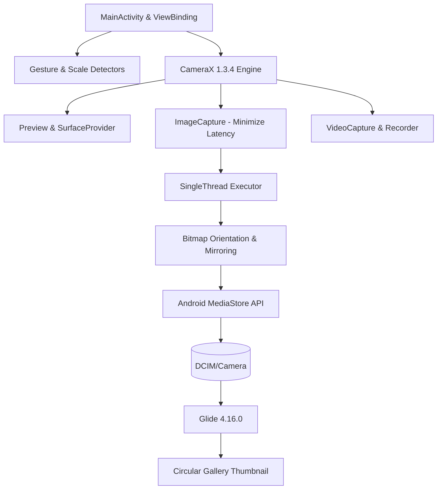

# 📸 Samsung One UI Camera for Android

<p align="center">
  
  
  
  
  
  
</p>

---

## 📖 Overview

**Samsung One UI Camera** is a modern, high-performance Android camera application engineered in **Kotlin** and powered by Google's **Android Jetpack CameraX (v1.3.4)**. Designed with Samsung's iconic **One UI** aesthetic, the app delivers a fluid, distraction-free photography and videography experience with signature yellow accents, realistic haptic feedback, zero-shutter-lag capture, and full hardware sensor resolution.

Whether capturing rapid action shots, shooting high-definition video, framing custom aspect ratios, or taking mirrored wide-angle selfies, this application mirrors the look, speed, and ergonomics of Samsung's flagship Galaxy camera system.

---

## ✨ Key Features

### ⚡ Zero-Perceived Shutter Lag & Silent Capture
- **Low-Latency Image Pipeline**: Built on `ImageCapture.CAPTURE_MODE_MINIMIZE_LATENCY` to seize the frame the exact millisecond the shutter is tapped.
- **Silent Operation**: Zero audio playback latency (completely silent shutter) with a 60ms simulated white screen flash blink and tactile haptic feedback.
- **Asynchronous I/O**: Heavy image processing, rotation matrices, and disk writes are delegated to a dedicated background executor thread (`Executors.newSingleThreadExecutor()`).

### 🌟 Maximum Hardware Sensor Megapixels
- **Full-Sensor Resolution**: Configured with `ResolutionStrategy.HIGHEST_AVAILABLE_STRATEGY` to exploit the camera hardware's true physical sensor resolution rather than downsampled preview streams.
- **Real-Time Megapixel Readout**: Dynamically analyzes the captured stream resolution and displays active megapixels in the top control bar (e.g., `12MP`, `50MP`, or `MAX MP`).

### 📐 Dynamic Aspect Ratio Framing
- **4 Native Formats**: Seamlessly toggle between **`3:4`**, **`9:16`**, **`1:1`**, and **`FULL`**.
- **Physical Animated Framing**: Transitions viewfinder bounds smoothly using AndroidX `TransitionManager` and `ChangeBounds` animations to reflect the physical framing.
- **Smart 1:1 Bitmap Cropping**: Performs centered mathematical square cropping before saving when shooting in 1:1 mode.

### 🎯 Tap-to-Focus & AE/AF Lock
- **One UI Focus Ring**: Single-tap anywhere on the preview to meter auto-focus (AF) and auto-exposure (AE) with an animated circular yellow ring.
- **AE/AF Lock Mode**: Long-press on any subject to pin exposure and focus indefinitely. A dedicated `AE/AF LOCK` badge illuminates at the top of the ring (tap badge to unlock).
- **Manual EV Compensation Slider**: An integrated vertical brightness slider with a draggable sun icon enables real-time exposure compensation (`-EV` to `+EV`) directly on the focus reticle.

### 🔍 Smooth Zoom & Quick Focal Length Pills
- **Pinch-to-Zoom**: Fluid dual-finger pinch zoom supporting the sensor's full hardware zoom range.
- **Floating Zoom Badge**: Transient zoom multiplier badge (`1.0x`, `2.4x`, etc.) with automatic smooth fade-out.
- **One UI Zoom Pills**: Quick-tap pills to snap to **0.6x** (Ultra-Wide), **1.0x** (Standard Wide), and **2.0x** (Telephoto).

### 🤳 Optimized Front Camera & Selfie Mirroring
- **Hardware Mirror Correction**: Automatically mirrors front-facing photos horizontally so captured selfies in the gallery match exactly what you see in the mirror preview.
- **Selfie Angle Switcher**: One UI dual-leaf/tree angle toggle:
  - **Single Angle (1.2x crop)**: Optimized framing for solo selfies.
  - **Group Angle (1.0x full field-of-view)**: Wide angle to fit friends and surroundings.
- **Smooth Flip Animation**: 180-degree flip transition when switching between rear and front sensors.

### 🎥 High-Definition Video Recording
- **High-Bitrate VideoCapture**: Powered by CameraX `VideoCapture` and `Recorder` with fallback strategies down from `Quality.HIGHEST`.
- **Clean Recording Interface**: Unnecessary controls auto-hide during recording to avoid accidental taps.
- **Recording Telemetry**: Floating high-contrast status badge with elapsed timestamp (`MM:SS`) and a pulsing red recording indicator.
- **Torch Light Toggle**: Instant torch illumination support while recording video in low-light environments.

### 🖼️ Real-Time Gallery Thumbnail Sync
- **Live Circular Thumbnail**: Displays the most recently captured image or video clip right next to the shutter button.
- **Pop-In Micro-Animation**: Smooth bounce animation triggered on every new capture.
- **Seamless System Handoff**: Tap thumbnail to open the photo directly in your default Android Gallery or Google Photos app.

---

## 🕹️ Gestures & Interaction Matrix

| Gesture | Context | Action Performed |
| :--- | :--- | :--- |
| **Tap Viewfinder** | Preview | Triggers Tap-to-Focus (AF) and Auto-Exposure (AE) |
| **Long-Press Viewfinder** | Preview | Engages **AE/AF Lock** with haptic confirmation |
| **Vertical Drag on Sun** | Focus Ring | Adjusts exposure compensation value (`+/- EV`) |
| **Swipe Up / Down** | Idle Viewfinder | Flips between Rear and Front (Selfie) cameras |
| **Swipe Left / Right** | Idle Viewfinder | Switches between **PHOTO** and **VIDEO** modes |
| **Pinch In / Out** | Preview | Adjusts camera zoom ratio smoothly |
| **Tap Zoom Pill** | Rear Camera | Snaps zoom directly to `0.6x`, `1.0x`, or `2.0x` |
| **Tap Angle Pill** | Front Camera | Toggles between Single (Standard) and Group (Wide) selfie angle |
| **Tap Shutter** | Photo Mode | Captures zero-latency high-res image (with countdown if timer set) |
| **Tap Shutter** | Video Mode | Starts / stops high-definition video recording |

---

## 🛠️ Architecture & Tech Stack



- **Language**: Kotlin 1.9.24
- **Architecture**: Single-Activity Architecture with Kotlin ViewBinding (`ActivityMainBinding`)
- **Camera Subsystem**:
  - `androidx.camera:camera-core:1.3.4`
  - `androidx.camera:camera-camera2:1.3.4`
  - `androidx.camera:camera-lifecycle:1.3.4`
  - `androidx.camera:camera-video:1.3.4`
  - `androidx.camera:camera-view:1.3.4`
  - `androidx.camera:camera-extensions:1.3.4`
- **Image Loading**: `com.github.bumptech.glide:glide:4.16.0` (with CircleCrop transformations)
- **Concurrency**: Kotlin Coroutines (`kotlinx-coroutines-android:1.8.1`) + Java ExecutorService for non-blocking I/O
- **Design & Layout**: Material Components 1.12.0, AndroidX ConstraintLayout 2.1.4, AndroidX Transitions
- **Build System**: Android Gradle Plugin 8.5.2, Gradle 8.x

---

## 📁 Repository Structure

```text
Camera/
├── app/
│   ├── build.gradle                # App-level build configuration and dependencies
│   ├── proguard-rules.pro          # Proguard rules for R8 optimization
│   └── src/
│       └── main/
│           ├── AndroidManifest.xml # Permissions, hardware features, activity declaration
│           ├── java/
│           │   └── com/samsung/camera/
│           │       └── MainActivity.kt   # Core camera controller, use cases, gestures
│           └── res/
│               ├── drawable/       # Custom One UI drawables (shutter, focus ring, pills, icons)
│               ├── layout/
│               │   └── activity_main.xml # Viewfinder, overlays, control bars, badges
│               ├── mipmap-*/       # Application launcher icons
│               └── values/
│                   ├── colors.xml  # Samsung One UI palette (#FFD600, #222222, etc.)
│                   ├── strings.xml # UI strings and localization
│                   └── themes.xml  # Fullscreen camera theme styles
├── gradle/                         # Gradle wrapper binaries & configuration
├── build.gradle                    # Root build configuration
├── gradle.properties               # JVM memory allocations and AndroidX flags
├── gradlew / gradlew.bat           # Unix/Windows Gradle wrapper scripts
├── settings.gradle                 # Project and module definitions
├── SamsungCamera.apk               # Pre-compiled ready-to-install Android APK
├── .gitignore                      # Git exclusion rules
└── README.md                       # Complete documentation
```

---

## 🔒 Permissions & Scoped Storage

The application implements compliant, privacy-preserving Android storage and hardware permissions:

| Permission | Scope | Purpose |
| :--- | :--- | :--- |
| `android.permission.CAMERA` | Mandatory | Accessing the camera hardware sensor |
| `android.permission.RECORD_AUDIO` | Video Mode | Capturing synchronized audio during video recording |
| `android.permission.READ_MEDIA_IMAGES` | Android 13+ (API 33+) | Loading latest photo thumbnail into gallery preview |
| `android.permission.READ_MEDIA_VIDEO` | Android 13+ (API 33+) | Loading latest video thumbnail into gallery preview |
| `WRITE_EXTERNAL_STORAGE` | Android 9 and below (<= API 28) | Saving media files on legacy devices |
| `READ_EXTERNAL_STORAGE` | Android 12 and below (<= API 32) | Accessing gallery media on legacy devices |

> [!NOTE]
> On Android 10 (API 29) and newer, all photos and videos are stored in public storage (`DCIM/Camera`) strictly through the standard Android **MediaStore API** using Scoped Storage guidelines, requiring zero broad storage permissions.

---

## 🚀 Getting Started & Building from Source

### Prerequisites
- **Android Studio** Ladybug (2024.2+) or newer
- **JDK**: Java Development Kit 17 (recommended: OpenJDK 17 or Temurin 17)
- **Android SDK**:
  - `compileSdk`: **35** (Android 15)
  - `minSdk`: **24** (Android 7.0 Nougat)
  - `targetSdk`: **35**

### 1. Clone the Repository
```bash
git clone https://github.com/<your-username>/SamsungCamera.git
cd SamsungCamera
```

### 2. Build via Command Line
On Windows (PowerShell):
```powershell
.\gradlew.bat assembleDebug
```
On macOS / Linux:
```bash
./gradlew assembleDebug
```
The resulting debug APK will be generated at:
`app/build/outputs/apk/debug/app-debug.apk`

### 3. Install Directly via ADB
```bash
adb install -r app/build/outputs/apk/debug/app-debug.apk
```

---

## 📲 Direct APK Installation (Quick Test)

A pre-built signed APK is included in the root of the repository:
1. Locate **`SamsungCamera.apk`** in the repository root.
2. Transfer it to any Android device running Android 7.0 (API 24) or newer.
3. Open the APK on the device, allow "Install from Unknown Sources" if prompted, and launch **Camera**.

---

## 🎨 Samsung One UI Visual Styling

- **Accent Color**: Samsung Yellow (`#FFD600`) & Amber (`#FFC107`)
- **Status Indicators**: Clean translucent pills (`#4D000000`) with smooth rounded corners (50dp corner radius)
- **Shutter Experience**: Dynamic dual-ring design with pressed scale animation (`scale down to 0.86x`)
- **Recording Mode**: Deep red active state (`#FF2A2A`) with synchronized flashing recording dot animation

---

## 🤝 Contributing

Contributions, feature requests, and bug reports are welcome!
1. Fork the Project.
2. Create your Feature Branch (`git checkout -b feature/AmazingFeature`).
3. Commit your Changes (`git commit -m 'feat: Add AmazingFeature'`).
4. Push to the Branch (`git push origin feature/AmazingFeature`).
5. Open a Pull Request.

---

## 📄 License

This project is open-source and available under the [MIT License](LICENSE).

---

<p align="center">
  Crafted with ❤️ for Android photography enthusiasts.
</p>
